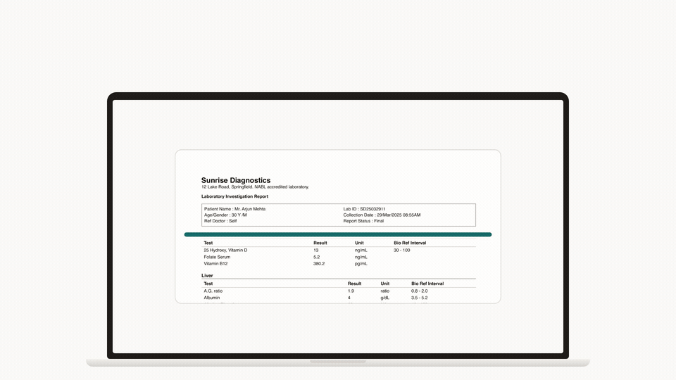
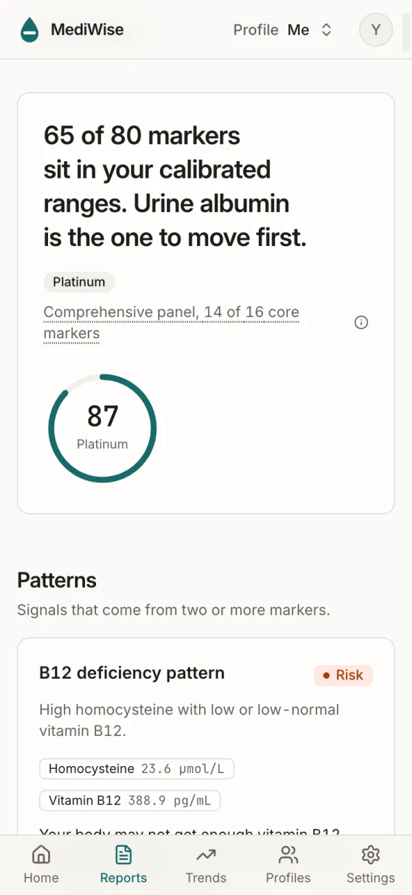
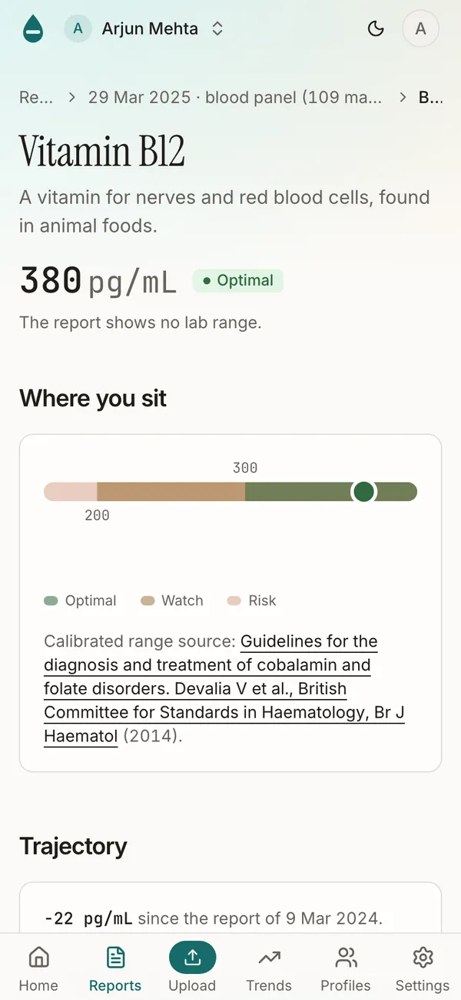
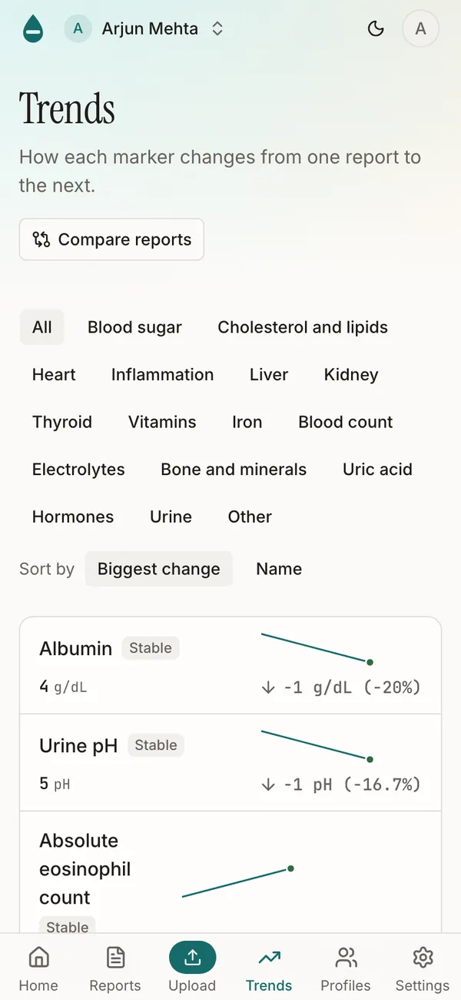
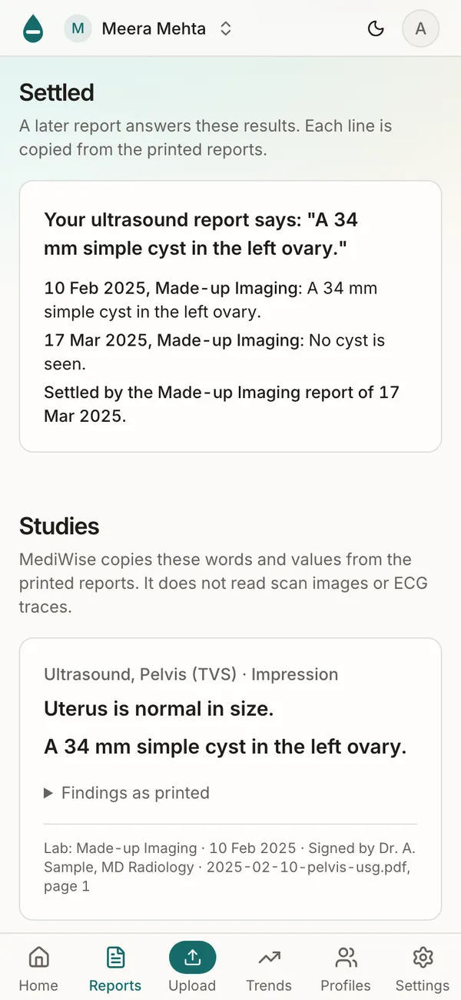
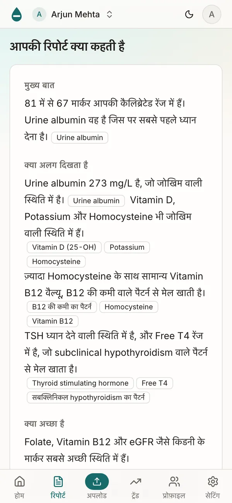

<div align="center">


[](https://github.com/theyashgupta/mediwise/actions/workflows/check.yml)
[](LICENSE)
[](https://nodejs.org)
[](CONTRIBUTING.md)



## Know what your next lab report says.

Upload a report from any lab as a PDF, photos or a patient portal screenshot. MediWise explains every marker and shows each value against the printed reference range and a range for your age, sex and ancestry. Then it tracks each marker across visits.

**[Open the app](https://app.mediwise.theyashgupta.me)** · **[See it in videos](#see-it)**

</div>

### Know where you stand and what to do first

Each report gets a score from 0 to 100 and a tier. Fixed rules make the score, so the same values always give the same score. The report puts the markers to work on first in order. It also lists follow-ups and the important markers that the lab did not measure. Take the report to your doctor as a print-ready page or as a link. Your doctor can open the link without an account.

<p align="center">
<picture>
  <source media="(prefers-color-scheme: dark)" srcset="apps/landing/public/screens/report-dark.webp">
  
</picture>
</p>

### Understand every marker

Each marker has its own page. The page tells you what the marker is, why it matters and what moves it. MediWise compares your value with a range for your age, sex and ancestry. Every range names its source. Rules also join two or more markers into one signal, such as B12 with homocysteine.

<p align="center">
<picture>
  <source media="(prefers-color-scheme: dark)" srcset="apps/landing/public/screens/marker-dark.webp">
  
</picture>
</p>

### Follow each marker over time, for all your family

With two reports, you can see how each marker changes from one visit to the next. Compare two reports, or open the year in review to see the markers that moved and the markers still at risk. One account keeps a profile for each person in your family: you, your parents, your partner and your children.

<p align="center">
<picture>
  <source media="(prefers-color-scheme: dark)" srcset="apps/landing/public/screens/trends-dark.webp">
  
</picture>
</p>

### Keep scans and repeat tests in one history

MediWise copies the words from your ultrasound, X-ray and ECG reports. When a line names a mass, a nodule, a stone or a similar finding, MediWise shows that line first. It tells you to ask your doctor. MediWise links two reports when both have the same study within 90 days. When the later report has no alert line, the earlier line moves to Settled. MediWise also finds reports that may belong together. Put them in one episode to see them in date order.

<p align="center">
<picture>
  <source media="(prefers-color-scheme: dark)" srcset="apps/landing/public/screens/settled-dark.webp">
  
</picture>
</p>

### Read your report in your language

MediWise shows in English and Hindi today. Choose Hindi in Settings or on the sign-in page. The app, the marker explanations and the report summary show in Hindi. Marker names and printed lines stay as the lab prints them.

<p align="center">
<picture>
  <source media="(prefers-color-scheme: dark)" srcset="apps/landing/public/screens/hindi-dark.webp">
  
</picture>
</p>

Every screen is from the app. The people and the reports are made up.

## See it

- **The app:** [app.mediwise.theyashgupta.me](https://app.mediwise.theyashgupta.me). It runs in the browser on a phone or a desktop.
- **The landing page:** [mediwise.theyashgupta.me](https://mediwise.theyashgupta.me), in English and Hindi.
- **The 30-second ad:** download the [16:9 cut](https://github.com/theyashgupta/mediwise/releases/download/demos-2026-10/mediwise-ad-16x9.mp4) for a desktop or the [9:16 cut](https://github.com/theyashgupta/mediwise/releases/download/demos-2026-10/mediwise-ad-9x16.mp4) for a phone.
- **The film for doctors:** [doctor-pitch-1080p.mp4](https://github.com/theyashgupta/mediwise/releases/download/demos-2026-10/doctor-pitch-1080p.mp4) (3:40) shows the features that matter in a clinic.
- **Forty walkthroughs:** [docs/demos](docs/demos/README.md) has one short video for each feature of the app.

All the videos are attached to the release [demos-2026-10](https://github.com/theyashgupta/mediwise/releases/tag/demos-2026-10).

**MediWise is for information. It does not give a diagnosis and it does not replace a doctor. MediWise is not a medical device.**

## For developers

MediWise is open source under the AGPL-3.0. The sections below tell how the app reads a report, what it is built with, and how to run it.

### How a report becomes a score

The LLM reads values. It never scores and it never recommends. The same report always gives the same score.

A report holds up to 20 PDFs or photos. A page goes to Claude as an image only when it has no text layer.

```
PDF or photos
  -> pdftotext -layout (poppler)            text layer, no LLM
  -> 1. extract   claude-haiku-5-5          values, units, ranges, lab, date
  -> alias match  packages/engine           most printed names map with no LLM
  -> 2. map       claude-sonnet-5-5         only the names no alias matches
  -> engine       packages/engine           status, score, tier, ranking, patterns, follow-ups
  -> 3. narrative claude-haiku-5-5          plain-English summary, checked by a validator
```

**The engine** in `packages/engine` is pure TypeScript with no I/O and no clock. It holds the marker library: names, aliases, units, conversions, calibrated ranges with sources, and the copy for each marker. Fixtures pin its output, so a changed range fails a test.

**The three Claude passes:**

| Pass      | Model               | Job                                                                                                                                                    |
| - | - | - |
| Extract   | `claude-haiku-5-5`  | Copies each value, unit and printed range off the page through a tool schema.                                                                          |
| Map       | `claude-sonnet-5-5` | Maps the printed names that no alias matches to a marker key. Most reports send only a few names.                                                      |
| Narrative | `claude-haiku-5-5`  | Writes the summary. A validator rejects a sentence over 20 words, a semicolon or a marker that is not in the report. One retry, then engine text only. |

A report with scans adds one study pass per scan page. A report with findings adds one short pass for the finding text.

**Cost.** The three passes on the 3-page sample report cost 0.48 US cents. The design target is at most 6 cents for a long report. A monthly spend cap (`CLAUDE_MONTHLY_CAP_CENTS`, default 20 USD) pauses the worker when the spend reaches the cap. The reasons for each model choice are in [docs/DECISIONS.md](docs/DECISIONS.md).

### Stack

| Part                            | Tools                                                                 |
| - | - |
| Web app (`apps/web`)            | Vite, React 19, TanStack Router and Query, Tailwind CSS v4, shadcn/ui |
| API and job worker (`apps/api`) | Hono on Node 24, zod, Drizzle ORM, Anthropic SDK, poppler             |
| Engine (`packages/engine`)      | Pure TypeScript, Vitest fixtures                                      |
| Landing page (`apps/landing`)   | Next.js static export, Motion                                         |
| Data and auth                   | Supabase Postgres, Supabase Auth (email and Google), Supabase Storage |
| Monorepo                        | pnpm 11 workspaces, Turborepo                                         |

### Quick start

You need Node 24, pnpm 11, poppler (`brew install poppler` or `apt-get install poppler-utils`), a free [Supabase](https://supabase.com) project and an [Anthropic API key](https://console.anthropic.com).

1. Clone the repository and install the packages.

   ```sh
   git clone https://github.com/theyashgupta/mediwise.git
   cd mediwise
   pnpm install
   ```

2. Copy the env examples. Each variable has a one-line comment.

   ```sh
   cp apps/api/.env.example apps/api/.env
   cp apps/web/.env.example apps/web/.env
   ```

3. Fill `apps/api/.env`: `DATABASE_URL`, `SUPABASE_URL`, `SUPABASE_SERVICE_ROLE_KEY` and `ANTHROPIC_API_KEY`. Set `RUN_WORKER=true` to read reports in the same process. Fill `apps/web/.env`: `VITE_SUPABASE_URL` and `VITE_SUPABASE_ANON_KEY`. The Supabase dashboard shows each value under Connect and Project Settings.

4. Create the tables. The API creates the private `reports` storage bucket on its first start.

   ```sh
   pnpm --filter @mediwise/api db:migrate
   ```

5. Start the API on port 3001 and the web app on port 5173.

   ```sh
   pnpm dev
   ```

6. Open http://localhost:5173 and create an account. Give the account report credits, then upload `apps/api/fixtures/golden/sample-2024.pdf`.

   ```sh
   pnpm --filter @mediwise/api credits:grant you@example.com 5 "local dev"
   ```

`pnpm check` runs the typecheck, the lint and the tests. On a machine with 8 GB of RAM, do not run `pnpm check` and `pnpm dev` at the same time.

The extraction eval runs the real pipeline on the two sample reports and compares the result with their golden files. It calls Claude and stops before it spends 1 USD.

```sh
pnpm eval:extraction
```

### Self-hosting

The production setup costs nothing until users arrive. The web app and the landing page run on Cloudflare Pages. The API runs in Docker on Render free, with a free Supabase project. [docs/DEPLOY.md](docs/DEPLOY.md) has the runbook, every environment variable, the smoke test and the rollback steps.

### Project structure

```
apps/
  api/        Hono API and the report worker
  web/        React app
  landing/    marketing site
packages/
  engine/     marker library and scoring engine
  shared/     zod schemas shared by web and api
  config/     tsconfig, ESLint and Prettier presets
docs/
  PRODUCT.md     what v1 includes
  DECISIONS.md   why the stack looks like this
  DESIGN.md      tokens, components and screenshots
  DEPLOY.md      production runbook
```

The folder rules for each app are in [.claude/rules/structure.md](.claude/rules/structure.md). ESLint enforces the import rules.

### Contributing

Read [CONTRIBUTING.md](CONTRIBUTING.md) before you open a pull request. It covers the setup, `pnpm check`, conventional commits and signed commits. File bugs and feature ideas through the [issue forms](https://github.com/theyashgupta/mediwise/issues/new/choose). Report a security problem in private, see [SECURITY.md](SECURITY.md). Everyone who participates agrees to the [Code of Conduct](CODE_OF_CONDUCT.md).

### License

[GNU Affero General Public License v3.0](LICENSE). If you run a changed MediWise as a network service, you must offer its source code to its users.
