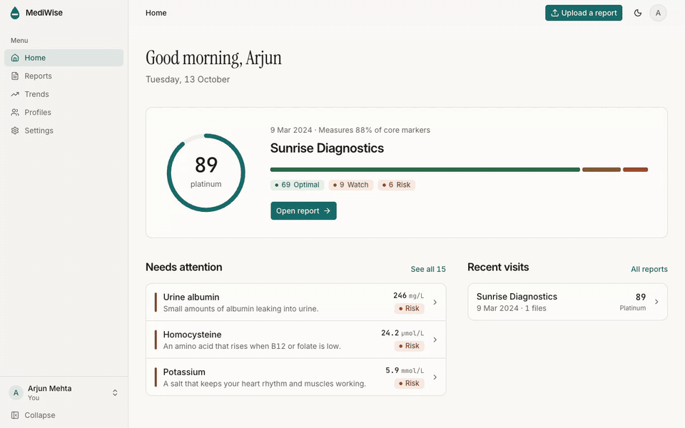

<div align="center">


**Upload a lab report. Understand every marker.**

MediWise reads a lab report and explains each marker in plain English.
It scores each marker against ranges for your age, sex and ancestry.
It tracks every marker across reports for your whole family.

[](https://github.com/theyashgupta/mediwise/actions/workflows/check.yml)
[](LICENSE)
[](https://nodejs.org)
[](CONTRIBUTING.md)



</div>

The demo uses a made-up person and a made-up report. You can upload the same file: `apps/api/fixtures/golden/sample-2025.pdf`.

MediWise is for information. It does not give a diagnosis and it does not replace a doctor.

## What it does

- **Reads any lab report.** Upload up to 20 PDFs or photos in one report. MediWise reads the text layer first and sends a page as an image only when it has no text.
- **Explains every marker.** Each marker gets a one-line description, what it is, why it matters and what moves it. Every range cites a source.
- **Scores against your ranges.** A deterministic engine compares each value with a range for your age, sex and ancestry. It gives a score from 0 to 100 and a tier.
- **Shows what to fix first.** The report page ranks the markers to move first. It lists follow-ups and the high-value markers that the lab did not measure.
- **Finds patterns.** Rules join two or more markers into one signal, such as B12 with homocysteine.
- **Reads scans and forms.** Ultrasound, X-ray and ECG pages become studies with their impression and measurements.
- **Tracks trends.** Two reports are enough to compare values and see each marker move over time.
- **Keeps family profiles.** One account holds reports for you, your parents, your partner and your children.
- **Exports for your doctor.** Each report has a print-ready page, black on white.

## How a report becomes a score

The LLM reads values. It never scores and it never recommends. The same report always gives the same score.

```
PDF or photos
  -> pdftotext -layout (poppler)            text layer, no LLM
  -> 1. extract   claude-haiku-5-5          values, units, ranges, lab, date
  -> alias match  packages/engine           most printed names map with no LLM
  -> 2. map       claude-sonnet-5-5         only the names no alias matches
  -> engine       packages/engine           status, score, tier, ranking, patterns, follow-ups
  -> 3. narrative claude-haiku-5-5          plain-English summary, checked by a validator
```

**The engine** in `packages/engine` is pure TypeScript with no I/O and no clock. It holds the marker library: names, aliases, units, conversions, calibrated ranges with sources, and the copy for each marker. Fixtures pin its output, so a changed range fails a test.

**The three Claude passes:**

| Pass      | Model               | Job                                                                                                                                                    |
| - | - | - |
| Extract   | `claude-haiku-5-5`  | Copies each value, unit and printed range off the page through a tool schema.                                                                          |
| Map       | `claude-sonnet-5-5` | Maps the printed names that no alias matches to a marker key. Most reports send only a few names.                                                      |
| Narrative | `claude-haiku-5-5`  | Writes the summary. A validator rejects a sentence over 20 words, a semicolon or a marker that is not in the report. One retry, then engine text only. |

A report with scans adds one study pass per scan page. A report with findings adds one short pass for the finding text.

**Cost.** The three passes on the 3-page sample report cost 0.48 US cents. The design target is at most 6 cents for a long report. A monthly spend cap (`CLAUDE_MONTHLY_CAP_CENTS`, default 20 USD) pauses the worker when the spend reaches the cap. The reasons for each model choice are in [docs/DECISIONS.md](docs/DECISIONS.md).

## Stack

| Part                            | Tools                                                                 |
| - | - |
| Web app (`apps/web`)            | Vite, React 19, TanStack Router and Query, Tailwind CSS v4, shadcn/ui |
| API and job worker (`apps/api`) | Hono on Node 24, zod, Drizzle ORM, Anthropic SDK, poppler             |
| Engine (`packages/engine`)      | Pure TypeScript, Vitest fixtures                                      |
| Landing page (`apps/landing`)   | Next.js static export, Motion                                         |
| Data and auth                   | Supabase Postgres, Supabase Auth (email and Google), Supabase Storage |
| Monorepo                        | pnpm 11 workspaces, Turborepo                                         |

## Quick start

You need Node 24, pnpm 11, poppler (`brew install poppler` or `apt-get install poppler-utils`), a free [Supabase](https://supabase.com) project and an [Anthropic API key](https://console.anthropic.com).

1. Clone the repository and install the packages.

   ```sh
   git clone https://github.com/theyashgupta/mediwise.git
   cd mediwise
   pnpm install
   ```

2. Copy the env examples. Each variable has a one-line comment.

   ```sh
   cp apps/api/.env.example apps/api/.env
   cp apps/web/.env.example apps/web/.env
   ```

3. Fill `apps/api/.env`: `DATABASE_URL`, `SUPABASE_URL`, `SUPABASE_SERVICE_ROLE_KEY` and `ANTHROPIC_API_KEY`. Set `RUN_WORKER=true` to read reports in the same process. Fill `apps/web/.env`: `VITE_SUPABASE_URL` and `VITE_SUPABASE_ANON_KEY`. The Supabase dashboard shows each value under Connect and Project Settings.

4. Create the tables. The API creates the private `reports` storage bucket on its first start.

   ```sh
   pnpm --filter @mediwise/api db:migrate
   ```

5. Start the API on port 3001 and the web app on port 5173.

   ```sh
   pnpm dev
   ```

6. Open http://localhost:5173 and create an account. Give the account report credits, then upload `apps/api/fixtures/golden/sample-2024.pdf`.

   ```sh
   pnpm --filter @mediwise/api credits:grant you@example.com 5 "local dev"
   ```

`pnpm check` runs the typecheck, the lint and the tests. On a machine with 8 GB of RAM, do not run `pnpm check` and `pnpm dev` at the same time.

The extraction eval runs the real pipeline on the two sample reports and compares the result with their golden files. It calls Claude and stops before it spends 1 USD.

```sh
pnpm eval:extraction
```

## Self-hosting

The production setup costs nothing until users arrive. The web app and the landing page run on Cloudflare Pages. The API runs in Docker on Render free, with a free Supabase project. [docs/DEPLOY.md](docs/DEPLOY.md) has the runbook, every environment variable, the smoke test and the rollback steps.

## Project structure

```
apps/
  api/        Hono API and the report worker
  web/        React app
  landing/    marketing site
packages/
  engine/     marker library and scoring engine
  shared/     zod schemas shared by web and api
  config/     tsconfig, ESLint and Prettier presets
docs/
  PRODUCT.md     what v1 includes
  DECISIONS.md   why the stack looks like this
  DESIGN.md      tokens, components and screenshots
  DEPLOY.md      production runbook
```

The folder rules for each app are in [.claude/rules/structure.md](.claude/rules/structure.md). ESLint enforces the import rules.

## Contributing

Read [CONTRIBUTING.md](CONTRIBUTING.md) before you open a pull request. It covers the setup, `pnpm check`, conventional commits and signed commits. File bugs and feature ideas through the [issue forms](https://github.com/theyashgupta/mediwise/issues/new/choose). Report a security problem in private, see [SECURITY.md](SECURITY.md). Everyone who participates agrees to the [Code of Conduct](CODE_OF_CONDUCT.md).

## License

[GNU Affero General Public License v3.0](LICENSE). If you run a changed MediWise as a network service, you must offer its source code to its users.
