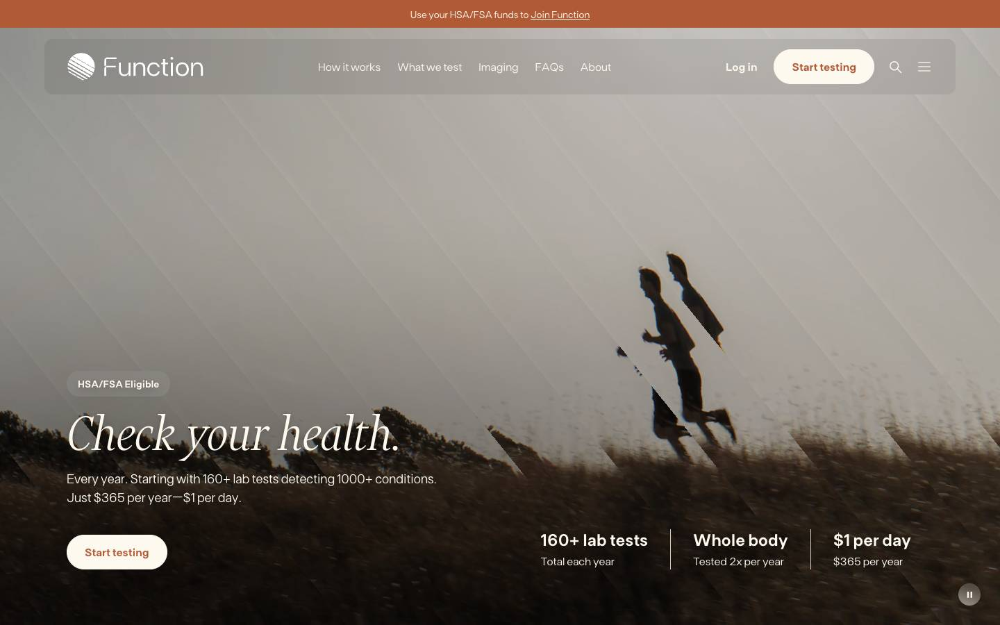
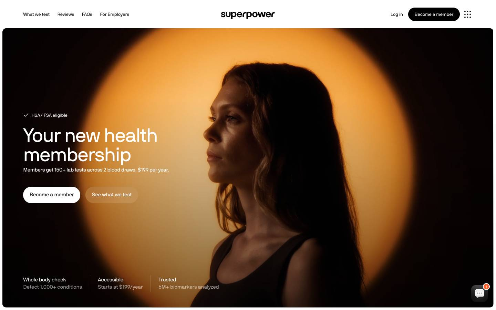
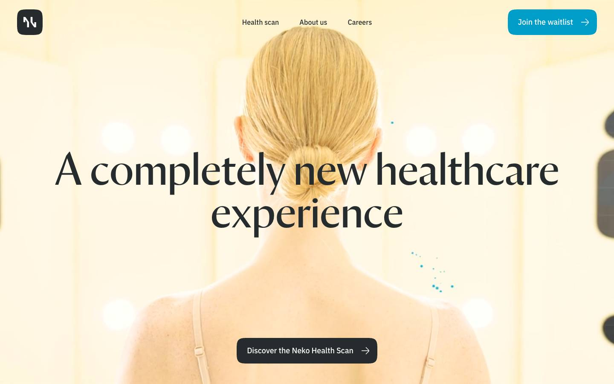
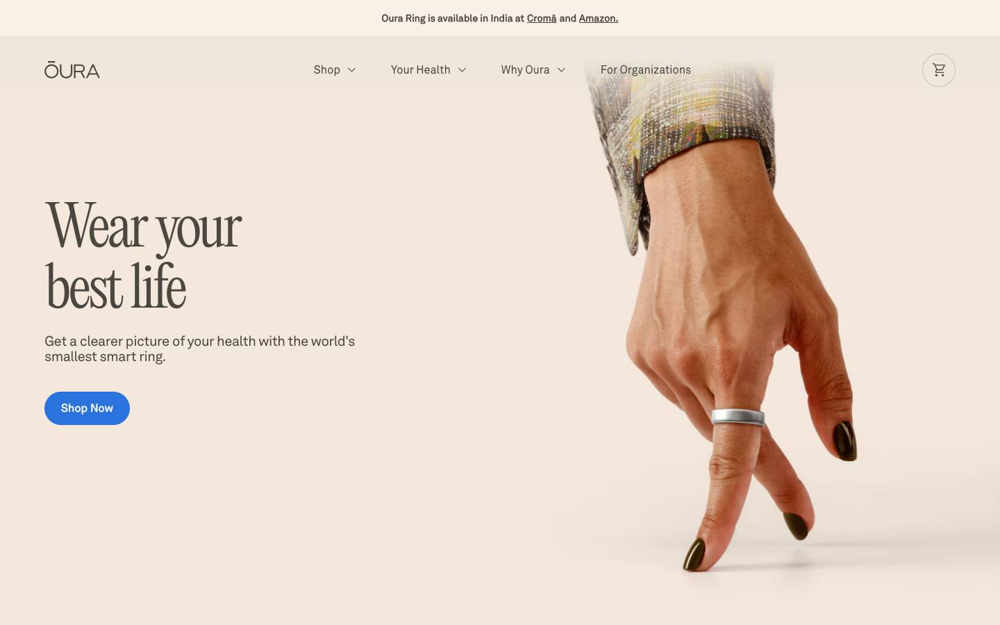
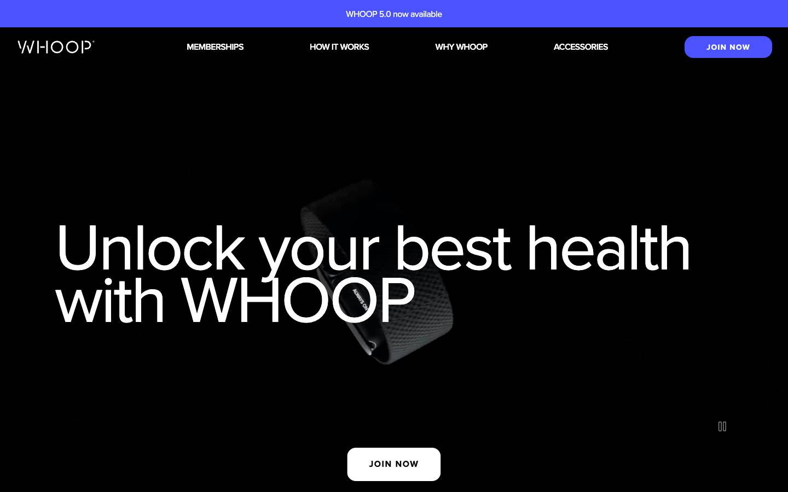
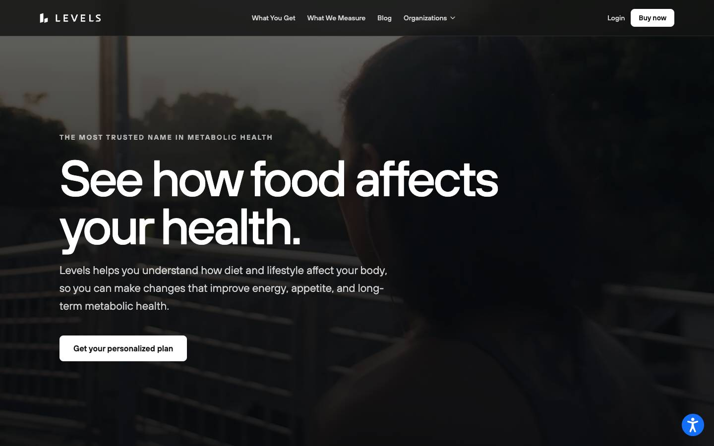
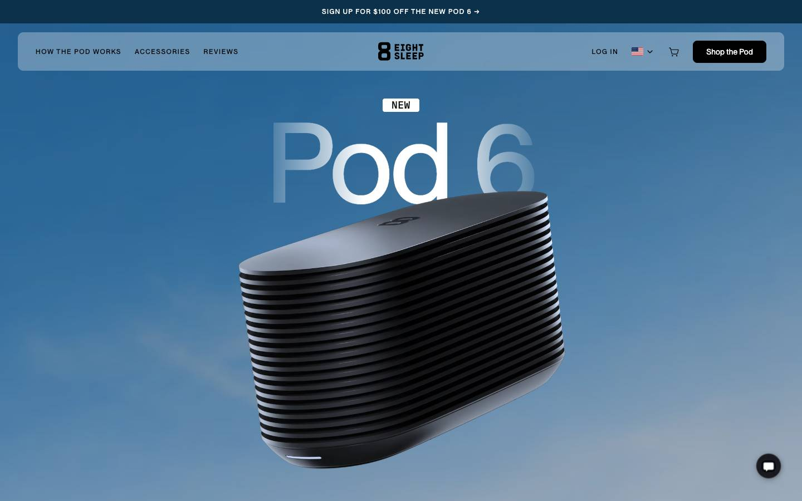
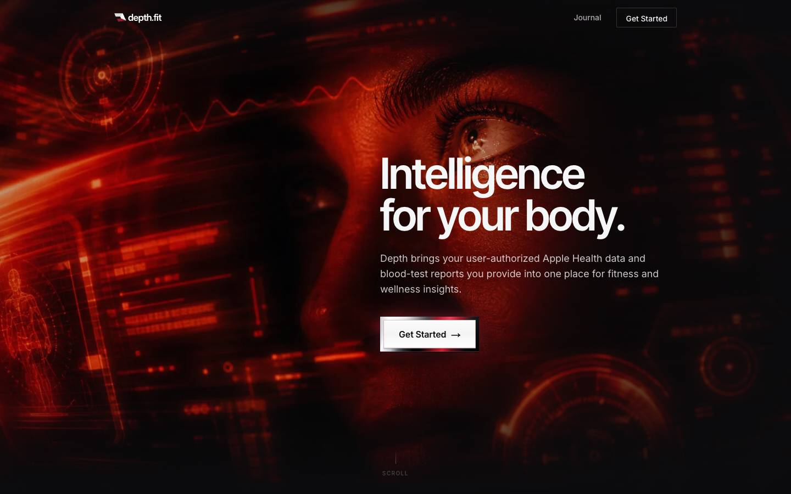
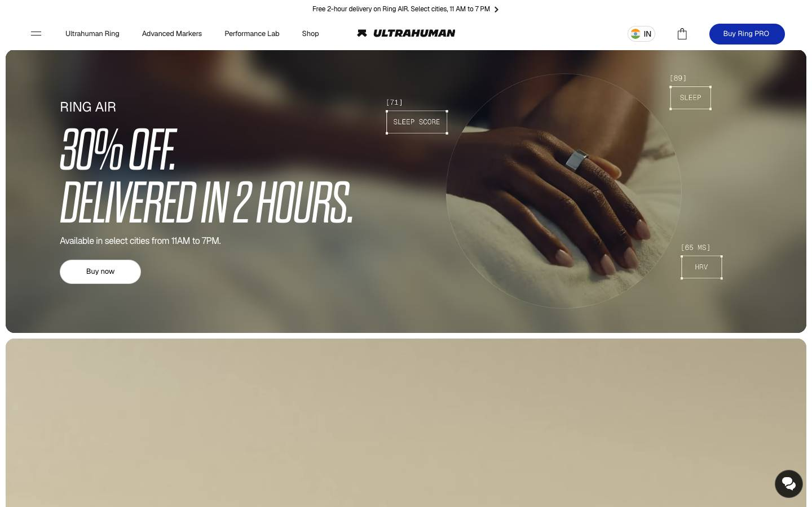
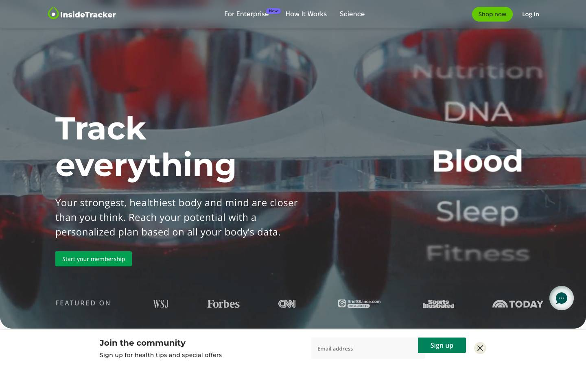

# Landing research

Date 2026-10-13. Method: Playwright at 1440 px, cookie banners closed, each page scrolled top to bottom. DOM checks covered video, animation and motion libraries.

## Function Health

The hero says "Check your health." in a light italic serif over a full-bleed outdoor video. The subhead gives the price: 160+ lab tests, $365 per year, $1 per day. A row of three stats sits under it, split by thin rules. The product appears as a numbered strip "Testing is easy" (01 lab tests, 02 results explained, 03 follow your plan). Lower down, a "Not your average checkup" card sets a standard checkup (~26 tests) against Function (160+). A "What could cost you $15,000 is $365" block repeats the price. Motion is light. The hero video plays behind a diagonal stripe overlay on one canvas (canvas count observed, the drawing method is inferred). A disease-name marquee and a testimonial marquee each carry a "PAUSE MOTION" button. The hero has its own "Pause hero motion" button at bottom right. Four testimonial videos are muted, preload none, with a poster, and play on click. No GSAP and no scroll-linked CSS. Only one animation ran at any scroll step. Type is Financier Display serif (80 px h1, 64 px h2, weight 300), FT Base sans and Fragment Mono for small labels. Colour is a cream page (#FEF9EF) with terracotta buttons and banner. Borrow: price in the hero, the 3-step strip, the comparison card, a pause button on every moving block. Avoid: the celebrity quote wall.

## Superpower

The hero is a rounded inset card with a full-width video of a woman against an orange disc. The headline "Your new health membership" is a plain sans. The subhead gives the price: 150+ lab tests, $199 per year. Three stat callouts sit at the hero bottom, split by thin rules: "Whole body check", "Accessible", "Trusted". "How it works" shows four numbered cards. Each card pairs a photo or phone frame with real app UI. The screens are an appointment card, a "Your Data" dashboard, an action list and a retest chart. GSAP is loaded with ScrollTrigger, Flip and TextPlugin on Webflow. 27 elements below the fold started hidden or offset before scrolling, so sections reveal on scroll. The step cards run CSS animations named howitworks-bg-enter and content-in. The nav turns into a floating dark pill after scroll. Videos are muted, preload metadata, with a poster. No pause control was found. A "$150 off" modal opened during the scroll. Type is one family, NB International Pro, regular weight. Colour is a white page with near-black text, with warm orange only in the photography. Borrow: three stat callouts, each step paired with a real app screen. Avoid: the discount modal on scroll.

## Neko Health

www.neko.health is a parked GoDaddy domain, not the company site. The screenshot is from www.nekohealth.com, which redirected to /gb/en. The hero is a centred serif headline, "A completely new healthcare experience" (Orleans, 100 px). It sits over a looping video of a woman in the scan room. There is one dark button and no price. The product appears in one pinned scene: a sticky full-height panel inside a 5,130 px parent. Tabs read Skin, Heart, Blood, Body. The left half shows skin with mole-tracking marker squares. The right half has a headline that reveals word by word. A list of capability labels (Imaging, Blood assessment, Cardiovascular check) sits above it. 35 elements below the fold started hidden before scrolling. A CSS marquee named "scroll" runs lower down. The hero video is muted, looping, preload auto and has no poster. Other videos are preload none. No pause control was found. Type is Orleans serif for headings and IBM Plex Sans for UI. Colour is white with dark slate text and one cyan button. Borrow: one pinned scene that steps through body systems with tabs. Avoid: a hero video with no poster and no pause.

## Oura

The site served the India version, with a banner for Croma and Amazon. The hero is "Wear your best life" in Editorial New serif (80 px, weight 300) on the left. A product photo of a hand with the ring fills the right. One blue "Shop Now" button. The product appears in photos and in an app screenshot collage (image alt text says so). There is no video on the home page. 17 elements below the fold started hidden and all were visible after the scroll, so content fades in once. No pinned scene, no marquee, no counter. One stat leads a section: "86% of Oura Members see their health improve". No price on the home page. Type pairs Editorial New serif with Akkurat sans. Colour is warm beige with warm grey text and a saturated blue button. Borrow: serif headline on warm neutrals, fade-in that runs once. Avoid: a bright accent that fights the warm palette.

## WHOOP

The site served /in/en. The hero is black, with "Unlock your best health with WHOOP" in proxima-nova at 120 px. Behind it a muted, looping product video plays, and a pause button sits at bottom right. Features appear as rows such as "Quantify how your body is feeling" and in a carousel. The membership block shows rupee pricing: ₹29,990 upfront, renews at ₹23,900, sold on Flipkart. The hero container is a parallax block (class name "full-bleed-hero_parallax"). A sticky call-to-action hides on scroll. 23 elements started hidden before scrolling and only 1 stayed hidden after. Videos are autoplay, muted, loop, preload metadata, no poster. Type is proxima-nova only, with all-caps nav. Colour is black and white with a violet-blue accent. Borrow: rupee price with the upfront and renewal amounts, a pause button on the hero video. Avoid: a 120 px headline on a black hero.

## Levels

www.levels.com loaded. The hero is "See how food affects your health." in ttHoves at 102 px over a dark, muted, looping video. The video has a poster and preload metadata. A tracked-caps eyebrow sits above the headline. Three trust callouts follow: 100,000+ lives changed, "The first and most trusted", and "Private, secure, and personalized" with HIPAA and SOC 2. Pricing is "Three ways to start", from $15 a month, and the base plan lists "Past bloodwork uploads". A quiz is offered as the first step. Motion is almost absent. No elements were hidden before scroll, and the animation count was 0 at nearly every step. No sticky scene, no marquee, no pause control on the hero video. Type is ttHoves with Inter. Colour is a dark hero and an off-white page (#F5F7F7). Borrow: a trust callout that names privacy compliance, tiered pricing. Avoid: an autoplay hero video with no pause.

## Eight Sleep

The hero is "Pod 6" at 200 px in NeueMontreal over a sky, with a 3D render of the hub. The headline colour is transparent, so the fill is likely a clipped gradient (inferred). Four CSS animations run on load: sky veil, sky dark, hero copy and hero title. Under the fold line: "Now starting at $1,999", 4.5 stars and 30,000+ reviews. "What's the Pod?" splits the product into Cover, Hub and App. A "New to Pod 6" list of four claims is in the DOM twice, which suggests a marquee (inferred). 61 elements started hidden before scrolling and 29 were still at opacity 0 after. The page has 11 videos, all muted, most preload auto, some with a poster. A "Play" button opens the film. No pause control for the looping videos was found. Type is NeueMontreal with IBM Plex Mono for labels. Colour is a blue sky hero, white page and black buttons. Borrow: mono labels for specs, a three-part product breakdown. Avoid: 11 videos with preload auto.

## Depth

depth.fit loaded with a full marketing page, so app.depth.fit was not needed. The hero is "Intelligence for your body." in Inter Tight (78 px, weight 600) on near-black (#0B0B0D). A red cinematic face with HUD overlays fills the background, and a "SCROLL" cue sits at the bottom. The copy says it reads Apple Health data and blood-test reports you provide. Three cards follow: "Always learning", "Always ahead", "Always adapting". A pinned scene shows a particle Vitruvian figure on canvas. A numbered rail beside it reads 01 Data inputs, 02 Protocol engine, 03 Daily adaptation. Lenis smooth scroll is active. The page has 9 canvases and 2 pinned sticky scenes. Between 26 and 126 animations ran at each scroll step (heroIn, ringDraw, railDraw, breathe). 117 elements started hidden before scrolling. No pause control was found, but the CSS has 5 prefers-reduced-motion rules. No price. Type is Inter Tight for headings and Inter for body. Colour is near-black with red. Borrow: a numbered rail beside one pinned visual, reduced-motion rules. Avoid: scroll hijack, constant ambient motion, a dark sci-fi tone.

## Ultrahuman

The site served /in/. The hero is a rounded promo card: "Ring AIR. 30% off. Delivered in 2 hours." in condensed Dharma Gothic caps. A muted, autoplay video shows a hand with the ring. Mono data tags float around it: "[71] SLEEP SCORE", "[89] SLEEP", "[65 MS] HRV". A "Blood Vision" image appears under Advanced Markers. A battery counter read "0 DAYS" before the scroll and "15 DAYS" after, so it counts up on view. Other motion: Lenis smooth scroll, a copy-reveal animation, a CSS marquee, a splash fade and one pinned dark section. 47 elements started hidden before scrolling. Videos are autoplay and muted, mostly preload auto, some with a poster. No pause control was found. No rupee price appears in the home page text. Type is Geist for UI, Dharma Gothic for display and JetBrains Mono for data labels. Colour is white and black with a royal blue button. Borrow: bracketed mono value tags on product imagery, one counter for one stat. Avoid: a discount-led hero and condensed display caps.

## InsideTracker

The hero is "Track everything" in Montserrat (78 px, bold) over a muted, looping video of blood tubes. The video has a poster and preload metadata. The words Nutrition, DNA, Blood, Sleep and Fitness on the right look like part of the video (inferred). A "Featured on" press logo row sits inside the hero. The product appears in a "What's inside 01/02" feature set: action plans, an AI guide named Terra, inner age and healthspan scores. Stat cards read "After 1 blood test", 80%, >10 years, >7K studies and >100K member lives. GSAP and ScrollTrigger are loaded. The stat cards use one-shot CSS fade-up animations (itFadeUp, itCardFadeUp). No sticky scene and no pause control. An email sign-up bar covered the bottom of the hero. The page is short (5,525 px). Type mixes Montserrat, Open Sans and Fixel Display. Colour is off-white (#F9F9F7) with a green button. No price on the home page. Borrow: stats tied to a result after one test, member quotes that name markers such as LDL. Avoid: a sign-up bar over the hero, three type families.

## What we take

- Put the price in the hero subhead in rupees, with what it buys. Confirmed on Function ($365) and Superpower ($199). WHOOP India shows upfront and renewal amounts in rupees.
- Lead with three stat callouts under the headline, split by thin borders. Confirmed on Superpower and Function. Levels does the same with trust callouts.
- Show a numbered 3-step strip: upload, read, track. Confirmed on Function (01 to 03). Superpower uses four numbered cards.
- Pair each step with a real MediWise screen, not a stock photo. Confirmed on Superpower: an appointment card, a dashboard, an action list and a retest chart.
- Add a "lab printout versus MediWise" comparison card. Confirmed on Function: standard checkup ~26 tests against Function 160+.
- Give every moving block a visible pause button and honour prefers-reduced-motion. Confirmed on Function (hero pause plus two "PAUSE MOTION" buttons). WHOOP has a hero pause. Depth ships reduced-motion rules.
- Use at most one pinned scene, with tabs for blood, ECG, ultrasound and X-ray reports. Neko pins Skin, Heart, Blood, Body this way. Depth pairs a pinned visual with a numbered rail.
- Tag values on product images in JetBrains Mono, like Ultrahuman's bracketed data labels.
- Keep the serif for the hero headline only and use sans for the rest. Function, Neko and Oura all pair a serif display with a sans UI.
- Use simple fade-up reveals that run once. Oura and InsideTracker do this with no scroll-linked effects.

## What we avoid

- Autoplay hero video with no poster or no pause. Neko, Levels and Ultrahuman do this.
- Smooth-scroll libraries that take over the scroll bar. Depth and Ultrahuman use Lenis.
- Modals and sign-up bars that cover the hero. Superpower showed a discount modal and InsideTracker an email bar.
- Celebrity quotes and press logo rows we cannot back up. Function and InsideTracker lean on them.
- Dark cinematic or sci-fi themes. Depth and WHOOP go this way, and it fights a calm clinical tone.
- Many videos with preload auto. Eight Sleep loads 11 videos.
